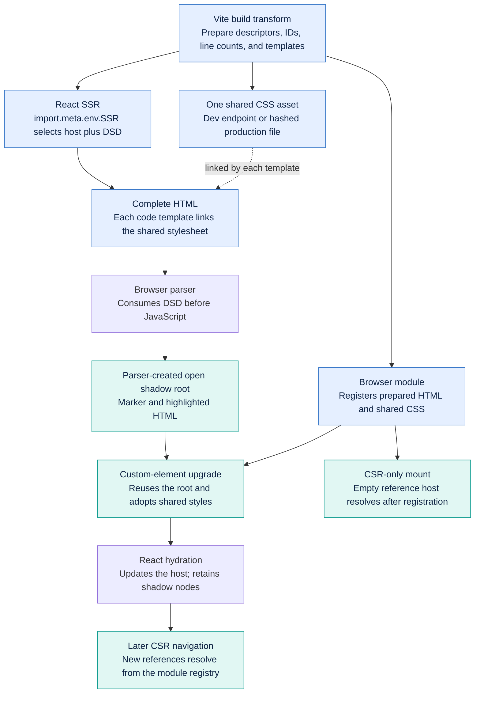
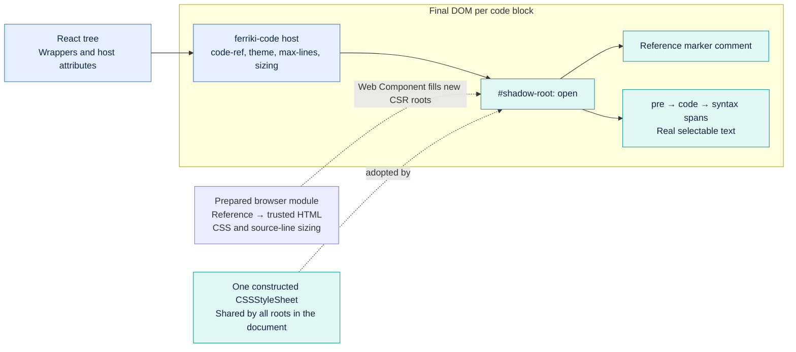

# Shadow code elements

Think of each code block as a small display with its own styling. React
controls where that display sits on the page and the attributes of its outer
element. The `<ferriki-code>` Web Component controls the code inside it.
Shadow DOM provides the boundary: page CSS selectors do not reach the code,
and React does not manage its individual tokens. The code remains real text
that people can select and copy.

Ferriki adds the syntax colors during the build. The browser receives the
prepared result and does not run a highlighter.


For the first page load with server rendering, the server sends the actual
highlighted HTML inside a template in the code element. The browser moves that
template's contents into the element's isolated area before JavaScript runs.
The template is gone, and the code is already visible. React then attaches to
the surrounding page and the outer code element; the code inside stays in
place. This path needs no extra HTML processing step after server rendering.

On later client navigation, the Web Component fills new code elements from
prepared HTML included in the browser modules. The highlighter still does not
run in the browser. The blocks share their style rules; the
[style delivery details](#share-styles) appear later in this guide.

This introductory illustration was generated with ImageGen; its
[saved prompt](assets/code-element-lifecycle-v2-prompt.md) records the visual.
The [implementation diagrams](#react-ssr-and-declarative-shadow-dom) show the
individual runtime steps and final DOM structure.

The optional `@ferriki/core/web-component` and
`@ferriki/core/web-component/server` entries also work without React. They
import no React runtime, native binding, asset loader, or highlighter. Prepare
the HTML at build time or on the server. The server helper remains available
for manually authored reference hosts.

## Use the custom element in React

```tsx
import { code } from "@ferriki/core/macro";
import { codeElementSizing, defineCodeElement } from "@ferriki/core/web-component";
import type {} from "@ferriki/core/react/macro";

const block = code(`export const answer = 42;`, { language: "ts" });
const sizing = codeElementSizing(block.code.split(/\r\n|\r|\n/u).length);
defineCodeElement({
  css: block.css,
  themeAliases: [],
  blocks: { answer_v1: block.html },
});

export function Example() {
  return <ferriki-code code-ref="answer_v1" className="example-code" style={sizing} />;
}
```

Configure the [Vite integration](inline-code-macros.md) for `code()`. This
example uses a single theme; for multiple themes, pass the same aliases as the
plugin. The type-only React macro import supplies the JSX tag declaration.
A result from `codeToHtmlWithCss` can also supply the HTML and CSS, provided
preparation runs outside the browser.

`blocks` maps IDs to trusted HTML. IDs contain one or more ASCII letters,
digits, underscores, or hyphens. Repeated registration with the same ID and
HTML is harmless; changing the HTML for an existing ID throws. Give changed
content a new ID. Registration can add blocks later and updates connected
hosts waiting for those references. An unresolved reference shows no code;
switching to it clears the previous content.

React passes neither highlighted HTML nor code children through this reference
host. Its only content prop is a string ID. Theme and parent updates retain the
shadow nodes. A changed reference replaces the content; repeating a reference
does not parse it again. The optional `codeRef` property reflects `code-ref`.
Use the `code-ref` attribute in server-rendered JSX; both browser upgrade and
the DSD HTML stage resolve that attribute. The `codeRef` property is useful for
imperative writes or client-only React rendering.

## React macro default

```tsx
import { Code } from "@ferriki/core/react/macro";

<Code
  language="ts"
  source={`export const answer = 42;`}
  maxLines={12}
  className="example-code"
  theme={darkMode ? "dark" : "light"}
/>;
```

The transform prepares each descriptor, assigns a content-derived ID, records
its source-line count, and prepares a DSD template. Identical descriptors share
an ID. The generated helper uses `import.meta.env.SSR` to select the server or
browser result; local `window` or `globalThis` bindings cannot change that
choice. On the server, it renders `<ferriki-code>` with the DSD template through
a server-only `dangerouslySetInnerHTML` value. The highlighter already escaped
the source, and custom
transformer markup remains trusted application input. The helper does not
convert tokens into React elements. In the browser, it registers prepared HTML
and CSS outside React, then returns an empty `<ferriki-code code-ref="…" />`
with runtime presentation props.

The server template contains the matching reference marker, the highlighted
HTML, and a link to the shared stylesheet. The document parser consumes the
template and creates the open shadow root before JavaScript runs. When the
element is defined, it reuses that root and preserves its token nodes; React
hydrates the host without moving its children or suppressing hydration. Later
client navigation creates empty reference hosts whose content comes from the
client module registry.

The default host also gets a module-level sizing style derived from the source
line count. This reserves space for client-only mounts until registration fills
the shadow root, while SSR also includes the prepared token markup in DSD.
`maxLines` optionally caps the visible block at a positive safe integer number
of lines; all highlighted code remains in the shadow root and longer blocks
scroll vertically. Shorter blocks stay short. Omit `maxLines` or pass
`undefined` for an unlimited block.

`className`, `theme`, and `maxLines` are runtime props. `maxLines` must resolve
to a positive safe integer when supplied. `source`, `language`, `meta`, and
`lineNumbers` remain compile-time literals. `theme` names a key in the plugin's
`themes` map; omitting it uses the first theme or the single configured theme.
A custom `render` function still receives the complete prepared descriptor and
uses ordinary Vite CSS delivery. It does not register the tag automatically.

## Migrate existing React macros

This default presentation transition targets Ferriki 1.1.0 as a one-time
exception during the initial 1.x adoption period. Existing macro calls remain
valid, but consumers of the previous DOM and CSS scoping need the migration
below. See [ADR 0019](../adr/0019-shadow-dom-code-elements.md#release-scope)
for the release scope.

Existing `<Code />` calls select the Web Component without an opt-in flag.
The generated host changes from a `div` containing highlighted HTML to
`<ferriki-code>` with shadow content. This changes observable markup and CSS
scoping: keep surrounding layout styles on the host, register rules for inner
code through the shared stylesheet, and select the theme on the host itself.
Page selectors and ancestor theme attributes no longer style inner tokens.

SSR now includes highlighted output in DSD by default. A browser-only mount has
an empty host until its module registers the content, while the host sizing
style reserves the expected space. Copy original source from the prepared
descriptor; DOM-based tools query the host's open `shadowRoot`. Titles, copy
buttons, and tabs can remain ordinary React wrappers around `<Code />`.

The HTML API and `code()` descriptor keep their existing contracts. An existing
custom `render` callback retains control over its result, including ordinary
light-DOM HTML when an application requires that integration.

## Client rendering with reserved space

The default React macro emits highlighted DSD during SSR. The source-line
reservation is still useful for client-only mounts and manual reference hosts
that have no DSD; it gives the empty host its expected space before JavaScript
registers the block. The macro applies this reservation and any `maxLines` cap
automatically. For a manual host, pass the same cap to `codeElementSizing` and
the `max-lines` attribute so the initial reservation matches the eventual
scroll viewport:

```tsx
<ferriki-code code-ref="answer_v1" max-lines={12} style={codeElementSizing(lineCount, 12)} />
```

The `maxLines` property accepts a positive safe integer, `null`, or
`undefined`; nullish values mean unlimited. The canonical attribute is
`max-lines`; React SSR may lowercase a JSX `maxLines` property to the `maxlines`
alias. Invalid attribute values are ignored and leave the block unlimited. The
sizing helper throws for an invalid line count or cap. It reserves the source
line count, limited by the cap when supplied, plus shared block padding. The
shadow `pre` uses
`--ferriki-code-max-block-size` for the same cap and remains vertically
scrollable, so no code is truncated. The runtime adds `tabindex="0"` to a capped
`pre` for keyboard scrolling unless the authored `pre` already has a `tabindex`.

For imperative hosts, apply the uncapped reservation with
`Object.assign(element.style, codeElementSizing(lineCount))`, then set
`element.maxLines = maxLines`; the property updates the cap styling.

The estimate is the line count times one line box, plus block padding. Source
CRLF, CR, and LF separators count as line breaks; a trailing blank line counts
too. Empty source reserves one line. The default line box is `1.3125rem`, matching
the code font's `0.875rem` size and `1.5` line spacing, with no block padding.
The host uses content-box sizing so its own borders and padding add equally
before and after upgrade.

Customize the estimate and the actual shadow presentation together:

```css
.example-code {
  --ferriki-code-line-height: 1.5rem;
  --ferriki-code-padding-block: 1rem;
}
```

Both variables must be lengths; use `1.5rem`, for example, rather than a unitless
line-height value. The shared shadow stylesheet reads the same variables as
the reservation. These small host sizing declarations do not duplicate theme
palettes. Registration, hydration, and theme changes retain the reserved size
in the browser fixture; changing references can change the source-line count
and its reservation.

This estimates nonwrapping preformatted lines. Custom transformer layout,
wrapping, and scrollbar geometry may require application-specific sizing.

## React SSR and Declarative Shadow DOM

The React macro emits DSD directly during SSR. Its server branch uses
`import.meta.env.SSR` and a server-only `dangerouslySetInnerHTML` value for the
prepared template; the browser branch returns an empty reference host and
registers the module's HTML and CSS. The SSR host has ordinary light-DOM
attributes and a DSD template:

```html
<ferriki-code class="example-code" code-ref="answer_v1">
  <template shadowrootmode="open">
    <!--ferriki-code:ENCODED_REFERENCE-->
    <link rel="stylesheet" href="SHARED_CSS_URL" data-ferriki-code-css />
    <pre><code>...prepared highlighted HTML...</code></pre>
  </template>
</ferriki-code>
```

`ENCODED_REFERENCE` matches the host's `code-ref`; `SHARED_CSS_URL` stands for
the single shared component stylesheet URL. The template contains the prepared
HTML, not a React tree of token elements. The macro's default SSR path needs no
post-render HTML rewrite.

The Vite plugin serves the stylesheet during development at
`${base}@ferriki/code-elements.css`. A production build emits one aggregated,
hashed `assets/ferriki-code-*.css` file. Deploy the CSS file emitted by the SSR
build with the application's public assets. The plugin re-emits this required
stylesheet when Vite suppresses ordinary SSR assets; the client and SSR builds
can produce different hashes. The default `/` base and absolute path or CDN
bases work. Direct macro SSR rejects `base: "./"` and `base: ""` because the
stylesheet URL would be ambiguous on nested routes. See the
[Vite guide](../node/vite/README.md) for the asset delivery contract.

The document parser consumes the template and creates the open shadow root
before JavaScript runs. Load and register the component after complete document
parsing and before React hydration. Do not define `<ferriki-code>` before the
parser reaches the template; its constructor would create the shadow root too
early for DSD. Upgrade reuses the parser-created root and preserves the
matching reference's nodes. The module registers the HTML
and CSS; React then hydrates the host without moving shadow nodes or disabling
hydration checks. Theme and parent updates retain the nodes. A later
client-rendered route uses the browser module's registry to populate new empty
reference hosts. Client-only mounts also use that registry and the macro's
source-line sizing reservation. The diagram below shows the separate SSR,
hydration, and later CSR paths.



### DOM and module ownership



Vite prepares both representations from the same trusted descriptor. React
owns the custom-element host, its attributes, and surrounding controls. The
HTML parser creates the SSR shadow root; after upgrade, `<ferriki-code>` owns
its token nodes and adopted stylesheet. The application serves the shared CSS
asset. The final DOM has no DSD template; the parser consumed it. A supplied
`render` callback replaces the built-in presentation and
owns its own markup and CSS.

The standalone `renderCodeElementShadows()` helper and
`plugin.api.renderCodeElements()` remain available for manually authored empty
reference hosts in complete server HTML. They add DSD after React has rendered;
they are not part of the default `<Code />` path. The helper skips hosts with
existing content or HTML-property attributes, and ignores scripts, comments,
and inert templates. Unknown eligible references throw. Repeating the helper
is idempotent. It accepts one complete HTML string; it is neither a streaming
parser nor a sanitizer.

For manual Vite server rendering, keep the same plugin instance used to
transform the SSR modules:

```js
const codePlugin = ferriki(options);
const server = await createServer({ plugins: [codePlugin] /* other options */ });
const { App } = await server.ssrLoadModule("/src/app.jsx");
const reactHtml = renderToString(React.createElement(App));
const html = codePlugin.api.renderCodeElements(reactHtml, {
  stylesheetHref: sharedCssUrl,
});
```

Serve `codePlugin.api.codeElementCss()` at `sharedCssUrl`. These manual APIs
read modules already transformed by the same plugin instance. These manual
APIs do not install an application SSR hook or the `sharedCssUrl` endpoint. Production
builds can save `codeElementBlocks()` and `codeElementCss()` for the standalone
helper. Use identical highlighting options in client and server builds so
content-derived IDs match. Streaming SSR and React Server Components are
outside the verified contract.

See [Declarative Shadow DOM](https://developer.mozilla.org/en-US/docs/Web/API/Web_components/Using_shadow_DOM#declaratively_with_html)
and [React's custom-element contract](https://react.dev/reference/react-dom/components#custom-html-elements).

## Share styles

In `styleMode: "inline"`, token and background colors are already style
attributes in the highlighted HTML. Shared CSS covers typography, line
annotations, and selectors for switching inline theme variables. There is no
separate resolved inline color palette to duplicate.

In `styleMode: "classes"`, the HTML carries class names and descriptor `css`
contains the token and theme rules. Include these rules in the shared CSS file
used by DSD before JavaScript. The default macro template links this shared
stylesheet. For manual hosts, `stylesheetHref` is optional, but class output
needs its styles available before upgrade for correct no-JavaScript colors.

DSD roots link to one CSS URL. This repeats a small link element, not the CSS
declarations. After the matching block and its CSS are registered, all roots in
a document adopt the exact same constructed `CSSStyleSheet`, and the component
removes their DSD links marked `data-ferriki-code-css`. A root awaiting its
block registration keeps that external stylesheet so partial or lazy
registration preserves its styles. No root receives an inline `<style>` tag.
Repeated registration and overlapping class rules are deduplicated; new rules
reach existing roots.
Browser-created link stylesheets before upgrade are not promised to share the
same `CSSStyleSheet` object.
See [shared constructed stylesheets](https://developer.mozilla.org/en-US/docs/Web/API/ShadowRoot/adoptedStyleSheets).

When registering class-mode blocks, supply their associated `css` in the same
call or register it before their `blocks`. The generated Vite helper registers
both together; manual consumers must do so too.

Use one theme alias profile per tag definition. Conflicting alias sets throw;
additional CSS must use the same theme mapping and compatible rules. The
registration defaults are `["light", "dark"]`; use `[]` for a single theme.
Aliases start with an ASCII letter or underscore and contain only ASCII letters,
digits, underscores, and hyphens. Theme switching uses Ferriki's default
`--shiki-` variable prefix. Add transformer presentation rules through the
shared `css` option. `codeElementStyles(aliases)` returns base and theme rules
for a manually prepared CSS asset.

CSS and HTML registry additions last for the definition's lifetime. Hot updates
can add new IDs and class rules; unused old entries remain until a page reload.
`code()` still uses ordinary Vite CSS delivery, so mixed light-DOM and shadow
consumers can also have a page stylesheet. Page CSS does not style shadow tokens.

Style the host for layout and surrounding presentation:

```css
ferriki-code.example-code {
  margin-block: 1rem;
  border-radius: 0.5rem;
  overflow: hidden;
}
```

Page selectors for inner `pre`, `code`, or token spans do not cross the shadow
boundary, and the component's stylesheet rules do not style the surrounding
page. This isolates code presentation from ordinary page resets and selectors;
it does not promise identical pixels in every document. Page CSS can style the
host, whose font family the inner `pre` inherits. Inherited properties and custom
properties can cross the boundary, `rem` dimensions still use the document's
root font size, and available fonts affect text metrics. Keep those inputs
consistent when matching presentation across pages. Set the theme attribute on
the host; an ancestor's theme attribute does not select it.
Code remains real selectable text. For exact-source copy buttons, use the
descriptor's `code`; queries for rendered content use `element.shadowRoot`.
Keep application controls outside the root.

## Direct HTML property and use without React

The string interface remains available for imperative or dynamic consumers:

```js
defineCodeElement({ css: preparedBlock.css, themeAliases: [] });
const element = document.createElement("ferriki-code");
element.highlightedCode = preparedBlock.html;
element.maxLines = 12;
document.querySelector(".example-slot").append(element);
```

The `maxLines` property may also be set to `null` or `undefined` to remove the
cap. Assigning an invalid value throws. For server-rendered or static hosts, use
the `max-lines` attribute and a matching `codeElementSizing(lineCount, maxLines)`
style so both the initial reservation and upgraded scroll viewport agree.

React 19 can also use `<ferriki-code highlightedCode={html} />`. Register before
React creates the host so it recognizes the property. `highlighted-code` and
the SSR-lowercased `highlightedcode` attribute provide the string interface too.
The component parses this trusted HTML internally; strings used as ordinary
React children would be escaped text. The latest explicit property or observed
attribute write selects the content source. `null` or `undefined` clears the
content and exposes an optional light-DOM fallback through a slot.

Property-mode React SSR serializes HTML as an escaped attribute. It can retain
a caller-supplied plain-source child for no-JavaScript output, but has extra
transport cost. The default reference macro has no such fallback. Importing and
calling `defineCodeElement` on a server returns `undefined`; a foreign tag
definition reports a conflict.

## Browser and trust boundary

The browser runtime requires Custom Elements, Shadow DOM, and constructed
stylesheets with `adoptedStyleSheets`. DSD also needs native declarative shadow
parsing. The browser fixture checks Chromium, Firefox, and WebKit; WebKit tests
do not certify every Safari version or device.

Ferriki escapes original source; custom transformer markup is trusted caller
code. Pass only HTML from that pipeline. Shadow DOM isolates selectors and DOM
ownership; it is not a sanitizer or security sandbox. CSR still parses HTML,
and DSD shifts that parsing to the document parser. Token DOM and layout work
remain, so isolation alone does not establish a speedup.

The [reference and DSD benchmark](../node/benchmarks/shadow-dom-spike/REFERENCE-DSD-REPORT.md)
records the measured SSR, setup, commit, and payload tradeoffs. It uses thin
adapters rather than the full generated macro helper, and excludes document
parsing and asset loading from browser timing. It does not measure complete
startup or isolated React CPU time.

The [hydration breakdown](../node/benchmarks/shadow-dom-spike/HYDRATION-BREAKDOWN.md)
shows that most of the inline reference call-to-commit interval is browser
style, layout, prepaint, and paint work pending after registration. Similar
light-DOM work happens before its timer starts. React hydrates the outer hosts;
the larger elapsed interval does not mean it processes the shadow tokens.

Strict [`require-trusted-types-for 'script'`](https://developer.mozilla.org/en-US/docs/Web/HTTP/Reference/Headers/Content-Security-Policy/require-trusted-types-for)
can reject the component's string sink during CSR or content changes; no
built-in Trusted Types policy or `TrustedHTML` hook is provided. Inline token
output still needs CSP permission for style attributes; classes mode avoids
token style attributes. The macro's SSR sizing hints are host style attributes
in either mode, so the application's policy must permit those too. Allow the
shared stylesheet asset in the application's stylesheet policy.
